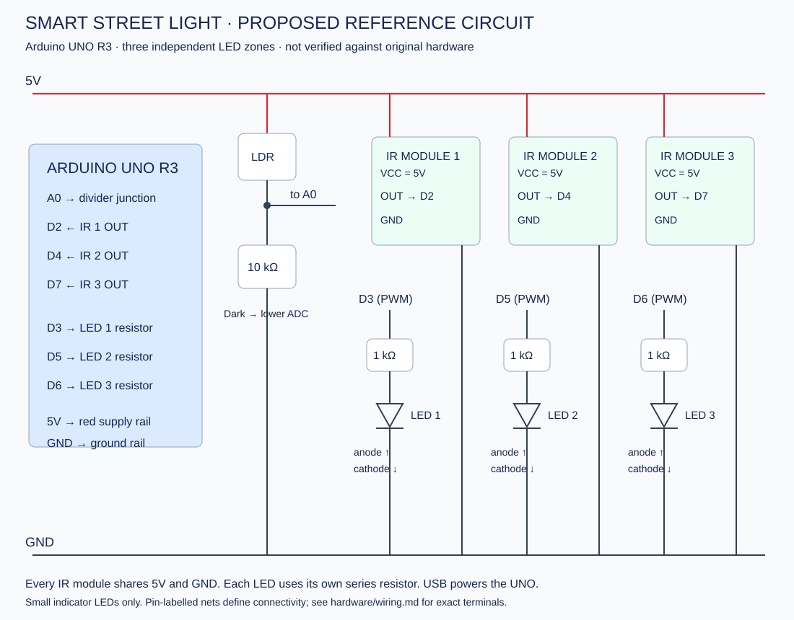

# Proposed reference wiring and bill of materials

These are new reference connections. Confirm your actual board and components before using them. The drawing and firmware describe the same three independent zones.

| Device terminal | UNO connection | Notes |
|---|---|---|
| LDR terminal 1 | 5V | LDR is non-polarized |
| LDR terminal 2 | A0 | Divider junction |
| 10 kΩ resistor end 1 | A0 | Same junction as LDR terminal 2 |
| 10 kΩ resistor end 2 | GND | Darkness lowers A0 voltage |
| IR 1 OUT | D2 | Active LOW assumed |
| IR 2 OUT | D4 | Active LOW assumed |
| IR 3 OUT | D7 | Active LOW assumed |
| Each IR VCC / GND | 5V / GND | Confirm module's printed pin labels and voltage rating |
| LED 1 anode | D3 through 1 kΩ | PWM zone 1 |
| LED 2 anode | D5 through 1 kΩ | PWM zone 2 |
| LED 3 anode | D6 through 1 kΩ | PWM zone 3 |
| All LED cathodes | GND | Usually short lead / flat package edge |

## Electrical details

Use three small indicator LEDs, one per output. With a typical 2 V LED and a 1 kΩ resistor, estimated full-on current is (5−2)/1000 ≈ 3 mA per LED. Verify your LED rating and forward voltage. Do not omit the resistors or connect a lamp/strip directly to GPIO.

Use USB power for this reference build. Do not connect an external voltage to the 5V pin while USB is connected. Check actual IR module current against the supply budget; do not assume every module has identical specifications. All devices share GND. Disconnect power while wiring.

A real higher-power lighting stage requires a suitably rated driver, supply and protection; it is outside this reference circuit. There is no transistor/MOSFET in the small-indicator-LED build.

## Sensor placement

Place the LDR away from the LEDs so their light does not create feedback. Aim each IR sensor at its associated zone and adjust its potentiometer. Reflective obstacle sensors have limited range and can be unreliable in outdoor sunlight; characterize your actual module rather than claiming a detection distance.
